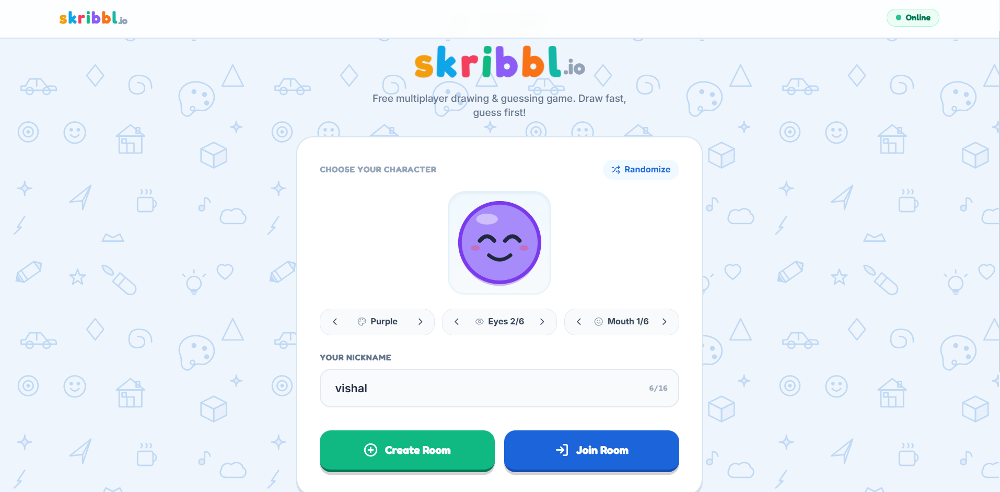

# Skribbl.io Clone — Real-Time Multiplayer Drawing & Guessing Game

A full-stack, real-time multiplayer drawing and guessing game inspired by Skribbl.io. Built using **React, TypeScript, Node.js, Express.js, and Socket.IO**, this application allows players to create rooms, invite friends, draw words, and compete through real-time guessing.

<p align="center">
  
</p>

<p align="center">
  <b>Draw • Guess • Compete • Have Fun!</b>
</p>

---

## 🚀 Live Demo

| Service | URL |
|---|---|
| Frontend | https://scribble-clone-zeta.vercel.app |
| Backend | https://scribble-clone-server-ov6l.onrender.com |
| Backend Health Check | https://scribble-clone-server-ov6l.onrender.com/api/health |

---

## ✨ Features

### 1. Multiplayer Room & Lobby Management
- Create public and private game rooms.
- Join rooms using unique 6-character room codes.
- Shareable room invitation links.
- Host controls and lobby management.
- Configurable player capacity, rounds, and drawing duration.
- Player list and lobby status.

### 2. Turn-Based Game Engine
- Automatic turn rotation between players.
- Drawer selects a word from multiple options.
- Categorized word selection.
- Server-controlled game timer.
- Automatic word selection when the drawer's selection time expires.
- Round completion and final winner announcement.
- Leaderboard with player rankings.

### 3. Real-Time Drawing Canvas
- HTML5 Canvas-based drawing interface.
- Real-time drawing synchronization using Socket.IO.
- Freehand drawing and geometric drawing tools.
- 14-color drawing palette.
- Multiple brush sizes: Small, Medium, Large, and Extra Large.
- Dedicated eraser tool.
- Multi-step undo functionality.
- Clear canvas functionality.
- Normalized drawing coordinates for different screen sizes.
- Role-based drawing permissions.

### 4. Real-Time Chat & Guessing
- Instant messaging within game rooms.
- Case-insensitive answer validation.
- Automatic correct-guess detection.
- Masked secret words for guessing players.
- Progressive hints during gameplay.
- Near-miss feedback for close guesses.
- Drawer and guesser role restrictions.
- Real-time score updates.

### 5. Avatar Customization & User Experience
- Customizable player avatars.
- Multiple avatar colors, eye styles, and mouth expressions.
- Randomize avatar option.
- Nickname customization.
- Colorful, playful interface.
- Responsive UI for desktop and mobile devices.

---

## 🛠️ Tech Stack

### Frontend
| Technology | Purpose |
|---|---|
| React | Component-based UI |
| TypeScript | Type safety |
| Vite | Development server and build tool |
| Tailwind CSS | Styling and responsive layouts |
| Lucide React | Icons |
| Socket.IO Client | Real-time communication |
| HTML5 Canvas | Drawing and rendering |

### Backend
| Technology | Purpose |
|---|---|
| Node.js | JavaScript runtime |
| Express.js | Backend server and API |
| Socket.IO | Real-time bidirectional communication |
| JavaScript ES Modules | Backend module system |
| In-memory Maps | Active room and game state management |

---

## 🏗️ System Architecture

The application follows a client-server architecture.

1. **Frontend:** React handles the user interface, drawing canvas, chat, lobby, and game controls.
2. **Communication:** Socket.IO establishes real-time communication between clients and the backend.
3. **Backend:** Node.js and Express handle application requests and Socket.IO events.
4. **Game Engine:** Room, Game, and Player classes manage game-related logic.
5. **Room Management:** In-memory Maps maintain active rooms and their associated player and game information.

### Real-Time Drawing Flow

```text
Drawer
   |
   | Drawing Events
   v
React Canvas
   |
   | Socket.IO
   v
Backend Server
   |
   | Room Broadcast
   v
Other Players
   |
   v
Updated Canvas
```

### Important Design Decision

The current implementation uses in-memory data structures for active rooms and game state. This provides fast access but does not persist active games across backend restarts. Redis or a persistent database can be introduced for future scalability and recovery.

---

## 📁 Project Structure

```text
scribble-clone/
│
├── client/
│   ├── public/
│   │   └── homeScreen.png
│   │
│   ├── src/
│   │   ├── components/
│   │   │   ├── Avatar/
│   │   │   ├── Lobby/
│   │   │   ├── GameCanvas/
│   │   │   ├── Chat/
│   │   │   ├── Leaderboard/
│   │   │   ├── GameTimer/
│   │   │   ├── WordModal/
│   │   │   └── GameOver/
│   │   │
│   │   ├── hooks/
│   │   │   └── useSocket.ts
│   │   │
│   │   ├── pages/
│   │   │   ├── HomePage.tsx
│   │   │   ├── CreateRoomPage.tsx
│   │   │   ├── JoinRoomPage.tsx
│   │   │   ├── LobbyPage.tsx
│   │   │   └── GamePage.tsx
│   │   │
│   │   ├── services/
│   │   │   └── socket.ts
│   │   │
│   │   ├── types/
│   │   │   └── index.ts
│   │   │
│   │   ├── App.tsx
│   │   ├── main.tsx
│   │   └── index.css
│   │
│   └── package.json
│
├── server/
│   ├── src/
│   │   ├── socket/
│   │   │   ├── roomHandler.js
│   │   │   ├── gameHandler.js
│   │   │   ├── drawingHandler.js
│   │   │   └── chatHandler.js
│   │   │
│   │   ├── game/
│   │   │   ├── Room.js
│   │   │   ├── Game.js
│   │   │   └── Player.js
│   │   │
│   │   ├── utils/
│   │   │   └── roomStore.js
│   │   │
│   │   ├── words/
│   │   │   ├── wordList.json
│   │   │   └── wordService.js
│   │   │
│   │   └── server.js
│   │
│   └── package.json
│
├── architecture.md
└── README.md
```

---

## ⚙️ Local Setup & Installation

### Prerequisites

- Node.js 18 or higher
- npm 9 or higher
- Git

### 1. Clone the Repository

```bash
git clone https://github.com/Vishal202-rgb/scribble-clone.git

cd scribble-clone
```

### 2. Setup Backend

```bash
cd server
npm install
```

Create a `.env` file inside the `server` directory:

```env
PORT=5000
NODE_ENV=development
CLIENT_ORIGIN=http://localhost:3000
```

Start the backend:

```bash
npm start
```

Backend URL:

```text
http://localhost:5000
```

Health check:

```text
http://localhost:5000/api/health
```

### 3. Setup Frontend

Open another terminal:

```bash
cd client
npm install
```

Create a `.env` file inside the `client` directory:

```env
VITE_BACKEND_URL=http://localhost:5000
```

Start the frontend:

```bash
npm run dev
```

Frontend URL:

```text
http://localhost:3000
```

---

## 🎮 How to Play

1. Open the application and enter your nickname.
2. Customize your avatar.
3. Create a room or join an existing room using its code.
4. Invite friends to the room.
5. The host starts the game.
6. The selected drawer chooses a word.
7. Draw the selected word while other players guess through chat.
8. Earn points for correct guesses.
9. Complete the rounds and check the final leaderboard.

---

## 🧪 Testing Checklist

The following areas are covered by the project's multiplayer testing:

- [x] Room creation and joining.
- [x] Multi-player room sessions.
- [x] Real-time drawing synchronization.
- [x] Canvas clearing and undo.
- [x] Word selection and turn rotation.
- [x] Countdown timer synchronization.
- [x] Correct guess validation.
- [x] Progressive hints.
- [x] Score allocation and leaderboard.
- [x] Host management and player disconnection handling.
- [x] Responsive interface testing.

---

## 🚀 Deployment

The application is deployed using:

- **Frontend:** Vercel
- **Backend:** Render

Production environment configuration:

Frontend environment variable:

```env
VITE_BACKEND_URL=https://scribble-clone-server-ov6l.onrender.com
```

Backend environment variables:

```env
PORT=<provided-by-hosting-platform>
NODE_ENV=production
CLIENT_ORIGIN=https://scribble-clone-zeta.vercel.app
```

The backend uses the hosting platform's assigned `PORT` in production.

---

## 🔮 Future Improvements

- Player reconnection and session recovery.
- Persistent user accounts and game history.
- Redis-based shared game state.
- Improved scalability for multiple backend instances.
- Additional drawing tools and word categories.
- Enhanced moderation and anti-cheat mechanisms.

---

## 👨‍💻 Author

**Vishal Kumar**

Full Stack Developer | Generative AI Enthusiast

- GitHub: [Vishal202-rgb](https://github.com/Vishal202-rgb)
- Project Repository: [Skribbl Clone](https://github.com/Vishal202-rgb/scribble-clone)

---

<p align="center">
  <b>Built with ❤️ using React, Node.js & Socket.IO</b>
</p>
